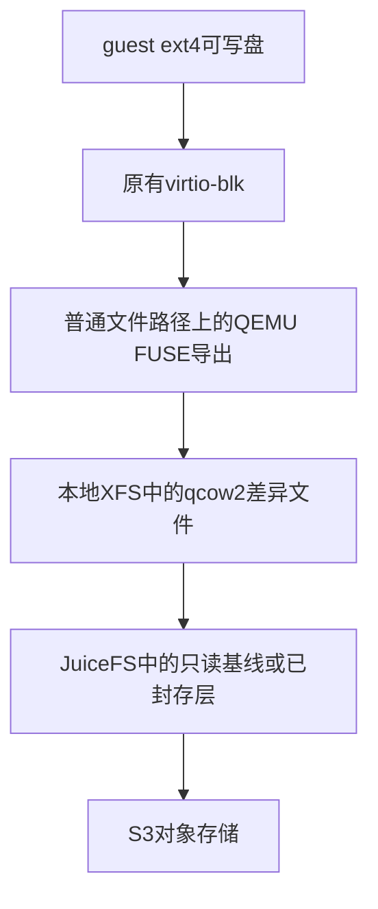

# 远端只读基线＋本地差异：文件导出后端的只读可行性检查

## 1. 问题

在完成PR #119完整SDK和JuiceFS原生克隆对照之后，如何用成熟组件构造“恢复时按需读远端、正常写入留在本地”的第二条路线，并继续遵守“不修改共享服务”的约束？gVisor和Firecracker是否能直接共用同一实现？

这是后续方案的源码/文档检查及工具只读预检，不是新后端已经部署或通过验收。正式三组性能已整轮通过后，才读取远端工具版本；采样期间没有增加其他存储实验。

## 2. 方法

只读查阅QEMU官方Storage Daemon文档、固定v8.2.0的FUSE导出源码、Linux FUSE I/O模式文档，以及本仓已有OverlayBD启动边界检查。v8.2.0只用于定位源码能力，不作为选定的生产版本；真正实验前仍需核对远端二进制、libfuse和内核组合。

来源：

- [QEMU Storage Daemon](https://www.qemu.org/docs/master/tools/qemu-storage-daemon.html)。
- [QEMU v8.2.0 FUSE导出源码](https://raw.githubusercontent.com/qemu/qemu/v8.2.0/block/export/fuse.c)：`fuse_export_create`、`fuse_setattr`、`fuse_fallocate`、`fuse_fsync`及`fuse_ops`。
- [Linux FUSE I/O模式](https://www.kernel.org/doc./html/next/filesystems/fuse-io.html)。
- [已有OverlayBD固定版本与边界检查](20261024T-pr119-overlaybd-v1018-snapshot-adapter-boundaries.md)。

## 3. 数据

| 项 | 证据及边界 |
|---|---|
| 成熟块格式复用 | QEMU Storage Daemon可独立承载块镜像功能；不需要再运行一台QEMU虚拟机。候选是本地qcow2差异文件加只读远端文件，尚未实测 |
| 文件形式导出 | 官方提供FUSE导出，把块节点呈现到一个已有普通文件路径。它提供的是另一个用户态数据进程，不是直接把qcow2格式交给Firecracker |
| gVisor所需文件操作 | 固定源码列有属性设置、分配/清洞、同步等处理；这不等于已经证明gVisor要求的mmap、扩缩容、清零和匿名FD生命周期都满足 |
| 版本相关行为 | Linux文档区分FUSE缓存/直通模式及共享mmap条件，不能凭“能open一个FD”判定可替换gVisor的私有文件 |
| 当前权限约束 | 已有OverlayBD检查记录了共享块前端初始化边界；本轮不会仅因TCMU已加载就启动可能重置全局状态的另一个服务 |
| 远端工具只读预检 | BareMetal当前PATH中没有`qemu-storage-daemon`或`qemu-img`；有`fusermount3 3.18.2`及字符设备`/dev/fuse`。没有安装工具、打开设备、创建挂载或启动后端 |

前五项为【源码/文档】，最后一项为【实测，只读工具预检】；无新块设备、FUSE挂载、VM、后端性能或生产可用数据。

## 4. 结论

【外推】QEMU文件导出可作为不新增宿主全局块配置的FC候选探针：guest仍用virtio-blk，下层复用成熟qcow2和文件导出。是否满足现有Async/Writeback、同步、故障和恢复契约必须实际验收，不能直接当作OverlayBD产品路线的替代决策。

【外推】gVisor适配明显更多。它用mmap和匿名文件句柄管理可写文件数据；单文件挂载点与现有“创建临时文件后立即unlink”方式不同，捕获还必须落在与内存一致的暂停窗口。因此应统一存储接口/版本/生命周期契约，先保留已工作的gVisor机制，不因两者都接受FD就强行共用实现。

## 5. 建议与改进项

FC最小候选如下，所有新增进程、路径和挂载只属于新任务：



这是拟议结构，不是当前实验部署。先验收读取、写入、零块/丢弃、同步和恢复，再接SDK；内存机制、ROFS和公共SDK不顺带改写。

保存可先探索：排空块I/O并暂停后，将已同步的本地差异文件在同一XFS卷克隆为不可变副本；源继续执行后，再上传该副本并克隆远端只读依赖，最终同步和ADX权威提交完成后才确认成功。该顺序能否复用现有FC暂停窗口、文件同步和错误处理，必须由真实交错测试证明。

恢复可探索：按需读远端只读层，新写入进入目标本地差异；显式记录层图、版本和所有者，限制层数并设计合并。不要让qcow2头中的旧宿主绝对路径成为新的隐式真相。依赖保护继续由ADX引用与运行时所有者承担，不新增平行目录服务，不让旧CAS sweep删除JuiceFS内部对象。

gVisor若后续确有收益，再单独验收预制私有FD的采纳、mmap/扩缩容/清洞、暂停时捕获、旧格式拒绝、控制进程/后端死亡及清理。不能用FC块探针替代它。现阶段也不承诺这一路线能改善仍由完整内存捕获主导的停顿。

### 当前sandboxd可复用入口（源码91dff2f）

| 入口 | 复用和需要改变的边界 |
|---|---|
| `storage.go::createFirecrackerOverlay`，531起 | 当前在普通文件上truncate/mkfs.ext4；新后端初始化仍应复用现有容量和guest盘契约，不改ROFS |
| `checkpoint_handler.go::Checkpoint`，225–310 | 先完成VMM保存/排空块I/O，再保持暂停捕获盘，随后恢复源；新增后端也必须保住这一顺序。盘捕获失败仍使已消耗的内存基线失效 |
| `checkpoint_handler.go::instantiateFirecrackerCheckpoint`，648起 | 旧目录布局验证摘要后复制overlay；新层图需要明确格式版本和独立加载分支，不能把qcow2文件当作旧raw overlay |
| `writable_directory_linux.go::prepareWritableOverlay/writableOverlay` | 已有目录FD锚定和所有者核验可复用；新文件导出需要同时核验远端依赖、本地差异、导出挂载和后端进程，不能只把路径换成任意FUSE文件 |
| `handler.go::Delete/recoverInstances` | 已有退出证明、恢复和保留未知对象的语义可复用；要增加后端进程/导出的恢复与回收，不替换ADX目录服务 |

固定源码：[保存切点](https://github.com/hky1999/sandboxd/blob/91dff2f686d4f3f18540d33c0851b127212d8567/pkg/runtime/firecracker/checkpoint_handler.go#L225)、[目录所有者](https://github.com/hky1999/sandboxd/blob/91dff2f686d4f3f18540d33c0851b127212d8567/pkg/runtime/firecracker/writable_directory_linux.go#L219)。

成本判断还应先检查现有复制：`reflink.go::cloneFileOpts`失败后调用`io.Copy`，不显式按稀疏区复制；Go/同卷文件系统仍可能做复制卸载，不能把该调用一概说成用户态逐字节搬运。包内已有`checkpoint.go::firecrackerDataExtents`使用SEEK_DATA/SEEK_HOLE。后续可量化保留稀疏区及本地不可变捕获能否减少无谓传输，再判断新增后端的收益；这类局部优化仍不等于真正按需恢复。此处仅源码判断，未改实现或给出新性能数值。

## 6. 可复现步骤

以下只用于远端只读预检，缺少工具时不安装到共享宿主：

```bash
command -v qemu-storage-daemon
command -v qemu-img
# 仅在上述命令存在时读取其版本；不是启动服务。
qemu-storage-daemon --version
qemu-img --version
```

工具存在性和已有fusermount3版本已读取，两个QEMU命令因不存在未执行。块/文件导出探针尚未执行。进入后端验证前另建独立路径/namespace/进程所有者，通过任务私有制品或容器准备固定版本，不安装到共享宿主；预检文件导出能力后再创建本任务资源。所有编译测试仅远端。

## 7. 现场清理披露

本检查只有文档/源码/远端工具存在性读取和本地文档编辑，没有启动QEMU、创建块设备/挂载或修改共享服务、宿主模块、全局缓存。它是后续可行性调研，与已发布20c389d的功能验收及三组性能结果分开，不算后端已实现。
