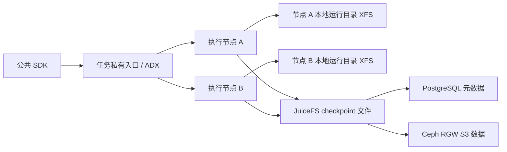

# PR #119 TAP 修复组合：JuiceFS 完整 SDK 和双向故障接管阶段总结

日期：2026-10-23。**本阶段完成官方完整 SDK 与双向故障接管主链路；开发计划阶段一的全部生命周期故障门尚未完成，两条新存储路线尚未开始。**

## 阶段定位与固定版本

这是在 BareMetal 私有 Pod/Kind 环境对固定 PR 候选的产品入口验收，不是生产高可用或竞品性能裁决。一个控制节点、两个执行节点都在同一物理机；三套 JuiceFS 客户端的 FUSE 设备号分别为 `0:1468 / 0:1874 / 0:1948`，是不同挂载，不能称为双物理故障域。

AKernel 固定 `365f7971f895f2b94cf390eefaab436600f005f0`，实际 ADX/Execd 发布包为 `6fb53d7331811535b6be5787ba026e03072f427b`，公共/原生 SDK 为 `0.2.0rc3 / 0.1.0rc3`。sandboxd 为 `d5acc3b` 加未提交 TAP 状态复位补丁；不是原始 PR 未修改通过。runsc 实际版本输出 `release-20260817.0-akernel.3-2-g7fdef444b108`，不能仅按发布包标签推断载荷。

候选镜像、ELF 摘要和本地质量门见 [TAP 修复验收](../checks/20261023T-pr119-tap-offload-local-sdk-acceptance.md)。本轮没有再次更换二进制或模板，没有本地编译测试，没有修改共享服务或父仓组件 gitlink。产品补丁与本轮新文档尚未作为新交付提交推送。

## 完成项

1. 复用已有 Rook、静态 PV、PostgreSQL、JuiceFS 工具，完成本任务真实存储部署。单 MON、单 OSD、单数据副本，40 GiB 任务文件经 loop 提供原始块存储，仅用于功能评估。
2. 三个真实 JuiceFS FUSE 挂载、4 KiB 跨客户端同步写摘要、PostgreSQL `fsync / synchronous_commit / full_page_writes=on` 均验证通过。JuiceFS 1.4.1，块 1024 KiB，`trash=0`；配置 `writeback=false`、节点缓存 4096 MiB。
3. 补齐真实 ADX 就绪门：新会话、可路由、资源可调度、实际镜像/ELF、三个稳定样本及空环境检查。没有用 Pod Ready 代替可调度。
4. 通过任务私有稳定入口执行官方 SDK：Firecracker integration 8、standalone 30；gVisor integration 8、standalone 30，共 **76 用例全通过、无跳过**。这些套件覆盖固定 OCI 镜像。
5. 附加默认镜像状态负载：每种运行时各五轮连续 checkpoint/reload、八项非法参数检查，以及各一次 512 MiB 确定性内存、PID、进程身份和打开文件校验；共 **12 次 checkpoint/reload**，四组沙箱均删除成功。
6. 公共 SDK 故障接管：gVisor 与 Firecracker 分别 A→B、B→A，共 **四条链路**通过。每条均验证源节点确实离线、1 MiB 真实根文件回滚、512 MiB 完整内存、目标继续写入、源节点重新加入不改变目标内容/运行时，以及最终删除。没有显式调用 reload 来冒充 SDK 自动接管。
7. 取得原始旧 CI 日志并分开归因：旧 `8cfb67e` 失败在动态网络策略用例清理时 ADX 权威对账拒绝删除；不是镜像构建失败，也不是本机 FC→gVisor TAP 复用故障。当前固定原始提交 `365f797` 的上游 CI 已成功。详见 [原始 CI 检查](../checks/20261023T-pr119-original-ci-failure-evidence.md)。

## 当前存储路径与实际证据

FC 恢复后的实际 FD 和映射确认：`overlay.ext4` 在目标本地 filestore/XFS，`memory` 仍打开于 JuiceFS，并有私有写时复制映射 `rw-p`。因此内存可以继续依赖远端文件，不能按 RPC 返回就认定读者结束。

gVisor 介质补测已完成：原观察器漏掉 `/filestore/` 别名，扩大到实际普通文件 FD 并直接核对文件系统后，确认恢复后 runsc-sandbox 持有 1 GiB 的 `/filestore/runsc-filestore-<id> (deleted)`，介质为 XFS；另有应用内存 `memfd:runsc-memory`，介质为 tmpfs。额外一条跨节点诊断也完整通过并清理，不并入性能样本。详见 [介质检查](../checks/20261023T-pr119-gvisor-restored-rwfs-backing-media.md)。匿名 filestore 的 FD 生命周期仍需在新后端中保留，不能直接把 checkpoint pages 当成可采纳的 filestore。

## 数字与口径

以下仅为路径开销观察。每个状态负载沙箱 1 vCPU、2 GiB RAM、1 GiB 私有存储；五轮基本样本没有额外填满应用内存。**本地 checkpoint 与 JuiceFS checkpoint 的持久化路径不同，SDK 入口也经历过调整；没有新旧交替对照，不是代码优化前后收益，也不是 guest 停顿。**

| 操作，五样本 P50 | 本地 XFS checkpoint | JuiceFS checkpoint |
|---|---:|---:|
| gVisor checkpoint 请求到完成 | 74 ms | 94 ms |
| gVisor SDK 同节点 reload | 245.293 ms | 296.255 ms |
| Firecracker checkpoint 请求到完成 | 2285 ms | 13614 ms |
| Firecracker SDK 同节点 reload | 2665.381 ms | 4905.023 ms |

完整 512 MiB 状态样本各只有一次：JuiceFS 下 gVisor checkpoint 1294 ms / reload 1598.483 ms，FC 8216 ms / 4435.684 ms；只能作为功能样本附带的耗时，不做稳定性或尾延迟结论。全部样本见 [同节点小型证据](../checks/evidence/pr119-juicefs-tapfix-20261023/same-node.json)。

跨节点四个功能样本的时间如下。A 为 worker，B 为 worker2。

| 运行时和方向 | checkpoint 到完成 | 源节点退出并撤销路由后，SDK 读到首个正确文件 | 同一起点到完整内存校验完成 | 发起故障操作到完整内存校验完成 |
|---|---:|---:|---:|---:|
| gVisor B→A | 1263 ms | 1849.253 ms | 3800.189 ms | 36.455 s |
| gVisor A→B | 1365 ms | 1816.073 ms | 3779.959 ms | 33.620 s |
| FC B→A | 8239 ms | 92.193 ms | 2591.507 ms | 34.805 s |
| FC A→B | 7933 ms | 2480.721 ms | 4821.862 ms | 35.955 s |

最后一列含受控节点停止、路由撤销/故障检测、只读观测及业务校验，不等于运行时恢复时间。前三个业务计时列也不能直接与竞品冷启动或增量停顿比较。

特别是 FC B→A，在 SDK 读计时开始前，网关已上报约 **1133.90 MiB GET**；不能把余下的 92 ms 读请求写成“跨节点恢复只需 92 ms”。这也解释了为什么必须从制品发布完成后开始保留计数，而不能只统计最后一次 SDK 调用。

网关计数器的单轮增量如下，GET 包含完整状态验证、重复范围、预读及缓存影响，不是唯一读取量，也未按内存/RWFS 精确拆分。

| 运行时和方向 | checkpoint 窗口 PUT 字节 | checkpoint 完成后至完整恢复校验结束 GET 字节 |
|---|---:|---:|
| gVisor B→A | 528.58 MiB | 850.13 MiB |
| gVisor A→B | 528.64 MiB | 810.82 MiB |
| FC B→A | 3072.01 MiB | 1653.24 MiB |
| FC A→B | 3072.01 MiB | 1659.90 MiB |

本轮 FC 配置没有显式 `checkpoint_mode`；固定源码 `handler.go:424` 默认 `full`，`checkpoint_handler.go:397` 在此模式每代选择 Full。当前数字不能代替历史增量窗口。FC 约 3 GiB PUT 表明必须分别量化全量内存和可写盘保存，不能预设 RWFS 克隆能消除全部成本。

没有清宿主缓存，没有竞品同口径 harness，没有至少十个交替样本或百样本尾延迟数据，不作 SOTA 或稳定性能收益结论。原始计数范围、四条状态证据及介质观测见 [跨节点小型证据](../checks/evidence/pr119-juicefs-tapfix-20261023/cross-node.json)。

## 新知识与保留失败

- 持久 TAP 的发送校验和卸载会跨运行时使用代次保留，必须由 raw Ethernet 使用方显式复位。已有原始红、修复绿及生产质量门，本轮完成产品链路回归。
- OSD 准备 Job 退出 0 不保证实际配置数据盘。任务设备别名之外，消费者使用的标准设备路径也需存在。本轮保存旧 Job 后按 UID 重试，只操作任务设备。
- 只重启本任务 Rook operator 促使重新对账；核对 FSID 后将本任务 `.rgw.root` 的 PG 数从 1 增至控制器要求的 8。初次安装 12 分钟超时、客户端 Ready 时序和 OnDelete 等待方式错误均保留。
- 第一次共享 SDK 76 用例通过后，附加 FC 五轮在第四轮因 kubectl port-forward 退出而中断。核对原状态并清理，没有重放未知 checkpoint。改用私有 NodePort 加现成 systemd socket 代理，端到端 TLS 校验不变；新编号完整重测通过。见 [入口中断检查](../checks/20261023T-pr119-sdk-port-forward-interruption.md)。
- 首次计数采集补丁因匹配到两个不同缩进的 Pod 查询而拒绝生成；改为完整行匹配后在远端语法检查通过再运行，没有修改运行中的夹具。

## 遗留与下一步

1. **阶段一仍未关闭**：后续已补四组角色进程崩溃接管、两运行时双读者保护与物理删除、复杂 RWFS、捕获超时与显式救援、SDK 调用者退出对账、S3 停顿、八路并发恢复、gVisor 仍打开共享输入时的两个角色崩溃，以及可写本地目录遮挡 JuiceFS 的拒绝发布；见 [故障进度](../schedules/20261023T-pr119-storage-failure-rwfs-progress.md)。内部物理删除屏障与多个 collector 的竞争仍没有完整实测；这些分项通过也不等于 PG/断电/生产 HA 通过。未证明安全的自动回收不能因主链路成功就开闸。
2. gVisor 恢复后 filestore 的 XFS 介质已通过额外诊断确认；继续核对保存/恢复如何复用私有 MemoryFile 和匿名 FD，给 JuiceFS 原生克隆适配划定最小改动范围，不顺带重写应用内存。
3. 完成当前基线的分相观测和同条件新旧交替：FC 分开内存保存、磁盘复制、同步提交；两运行时都分开恢复就绪、后台读取及完整校验。增量模式要先确认与当前共享文件制品/父依赖契约兼容，不能只翻开关就当成已验收优化。
4. 然后按执行计划开展 JuiceFS 原生克隆和远端只读基线加本地差异层对照，分别记录运行期写入、再次 checkpoint、后台读量、引用和回收，不只比较一次启动。
5. 组件修复的独立提交/推送、父仓交付和可复现脚本整理尚未完成；不把远端私有二进制算作外部可获取的交付。

## 现场与复现

远端 `N=/mnt/m0-xfs/akernel-pr119-followup-20261022.qbGAw9tp`，`Q=$N/round-365f797-20261023.clPWh2h0`，`S=$Q/tap-checksum-fix/storage`。成功入口为 `S/run06/terminal.json`、`S/sdk-full02/terminal.json` 和 `S/cross-node05/terminal.json`。完整过程见 [本轮检查](../checks/20261023T-pr119-juicefs-sdk-tapfix-acceptance.md)。

最终任务 API Server readyz、三个 Kubernetes 节点和 AKernel Pod 健康；权威 Environment 记录为 0。任务存储和代理保留用于后续门禁，专属块设备没有提前回收。XFS 可用 739762581504 字节，约 689 GiB，没有清理其他使用者资源。临时 inotify 值未改，旧环境、共享服务、其他并行工作和父仓三个组件指针未变。
